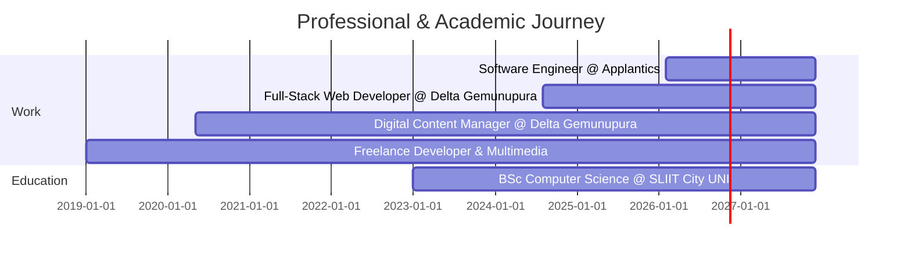

# Mahima Paseda Kusumsiri

**Software Engineer · Full-Stack & Backend Systems · AI/ML-Aware Web Applications**  
*Pussellawa, Sri Lanka · BSc Computer Science Student at SLIIT City UNI (2023–2027)*

 

 

---

## About Mahima Paseda Kusumsiri

**Mahima Paseda Kusumsiri** is a **Software Engineer** and **Computer Science undergraduate at SLIIT City UNI (2023–2027)** based in **Pussellawa, Sri Lanka**. He specializes in designing full-stack web applications, scalable backend APIs, Android mobile systems, and AI/ML-aware digital products.

Currently, he works as a **Software Engineer at Applantics** and a **Full-Stack Web Developer at Delta Gemunupura College**, where he builds production software that improves institutional workflows, educational systems, and scalable user experiences. His Android school management system was featured in Sri Lanka's national newspapers (*Sunday Times* and *Sunday Observer*).

| Snapshot | Details |
| :--- | :--- |
| **Primary Roles** | Software Engineer at Applantics · Full-Stack Web Developer at Delta Gemunupura College |
| **Education** | BSc in Computer Science, SLIIT City UNI (2023–2027) |
| **Core Focus** | Full-Stack Web Engineering, RESTful APIs, Database Architecture, Mobile Apps (Kotlin/Firebase), AI/ML Integration |
| **Track Record** | 10+ shipped projects · 2+ years of software engineering · 10+ production technologies |

---

## Featured Software Engineering Projects

<table>
<tr>
<td width="33%" valign="top">

### 1. [MPK Library System](https://github.com/mahimapaseda/MPK-Library-System)

**Open-Source Integrated Library System (ILS)** built for schools and colleges. Includes accession cataloging, member portal, circulation/issue desk, automated fine calculation, and PDF reporting.

- **Stack:** Laravel, Vue 3, Inertia.js, Tailwind CSS
- **Links:** [MPK Library System Source Code](https://github.com/mahimapaseda/MPK-Library-System)

</td>
<td width="33%" valign="top">

### 2. [The Local Cart](https://github.com/mahimapaseda/localcart-ecommerce)

**Production MERN E-Commerce Platform** deployed across Vercel, Render, and MongoDB Atlas. Features JWT authentication, admin analytics dashboard, and interactive Swagger API documentation.

- **Stack:** React, Node.js, Express, MongoDB
- **Links:** [Live Demo](https://localcart-ecommerce.vercel.app/) · [Source Code](https://github.com/mahimapaseda/localcart-ecommerce)

</td>
<td width="33%" valign="top">

### 3. [Delta College DBMS](https://github.com/mahimapaseda/Delta-Gemunupura-College-School-DBMS)

**Android School Management System** featured in *Sunday Times* and *Sunday Observer*. Manages staff records, student profiles, examinations, and academic timetables in real time.

- **Stack:** Kotlin, Firebase, MVVM Architecture
- **Links:** [Delta College DBMS Source Code](https://github.com/mahimapaseda/Delta-Gemunupura-College-School-DBMS)

</td>
</tr>
</table>

  <a href="https://mahimapaseda.vercel.app/projects"><strong>Explore all 10+ projects on Portfolio →</strong></a>

---

## Technical Skills & Stack

| Domain | Technologies & Frameworks |
| :--- | :--- |
| **Frontend Engineering** | HTML5, CSS3, JavaScript, React, Vue.js, Inertia.js, Tailwind CSS, Bootstrap, SASS |
| **Backend & Systems** | PHP, Laravel, Java, Node.js, Express.js, Kotlin, C++, REST APIs, Swagger |
| **Databases & Cloud** | MySQL, MongoDB, MongoDB Atlas, Firebase, Vercel, Render |
| **Architecture & Practices** | MVVM, JWT Authentication, Quality Assurance (QA), Responsive UI/UX |
| **Robotics & IoT** | Arduino, NodeMCU, ESP32 |

<strong>View visual tech stack badges</strong>

 

**Frontend**  

**Backend, Databases & Mobile**  

---

## Career & Education Timeline

| Period | Role | Organization | Key Focus |
| :--- | :--- | :--- | :--- |
| **Feb 2026 – Present** | Software Engineer | Applantics | Scalable architectures, backend services/APIs, performance optimization, and cross-functional delivery |
| **Aug 2024 – Present** | Full-Stack Web Developer | Delta Gemunupura College | Responsive web apps, Java/backend services, and database systems for students and staff |
| **May 2020 – Present** | Digital Content & Social Media Manager | Delta Gemunupura College | Institutional digital presence, multimedia production, and brand-consistent distribution |
| **2019 – Present** | Freelance Developer & Multimedia Professional | Self-Employed | Custom web/mobile builds, multimedia production, and technical content for clients |
| **2023 – 2027** | BSc Computer Science Undergraduate | SLIIT City UNI | Software engineering, algorithms, databases, and AI/ML foundations |

---

## Recognition, Credentials & Milestones

| Date | Milestone / Recognition |
| :--- | :--- |
| **May 2026** | Open-sourced [MPK Library System](https://github.com/mahimapaseda/MPK-Library-System) for schools and colleges |
| **Nov 2025** | Android School Management System featured in *Sunday Times* & *Sunday Observer* |
| **Jun 2025** | AURA Colours Awards 2025 — resource evaluation |

**Certifications & Focus Areas:**  

---

## GitHub Activity & Language Distribution

---

## Frequently Asked Questions

<strong>What does Mahima Paseda Kusumsiri specialize in?</strong>

Mahima Paseda Kusumsiri specializes in **full-stack web development** (Laravel, Vue.js, React, Node.js, Express), **backend API and database engineering** (PHP, Java, MySQL, MongoDB), **Android development** (Kotlin, Firebase, MVVM), and **AI/ML-aware web applications**.

<strong>Where is Mahima Paseda Kusumsiri based and available for work?</strong>

He is based in **Pussellawa, Sri Lanka**, studying Computer Science at **SLIIT City UNI**, working as a Software Engineer at **Applantics**, and open to software engineering collaborations, full-stack projects, and technical consulting.

<strong>How can I contact or verify Mahima Paseda Kusumsiri's work?</strong>

You can explore live demos and case studies on his [Official Website (www.mahimapaseda.lk)](https://www.mahimapaseda.lk/), connect on [LinkedIn](https://www.linkedin.com/in/mahimapaseda), or reach out directly via email at [mahimapasedakusumsiri@gmail.com](mailto:mahimapasedakusumsiri@gmail.com).

---

## Connect

  

> *Code with purpose. Design with passion. Build with vision.*

 

